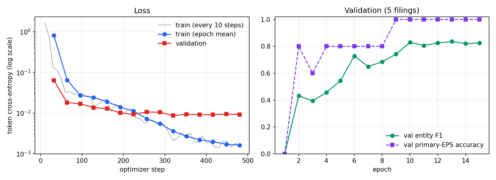

# EPS extraction from SEC 8-K earnings releases

Fine-tuning `microsoft/deberta-v3-base` as a token classifier that tags earnings-per-share figures in 8-K
earnings releases, with labels built from an LLM pre-labeling pass that is checked against 10-Q XBRL,
a self-consistency filter, and a manual spot-check. The fine-tuned model is compared with a zero-shot LLM
baseline on a held-out test split.

**Headline result (12 held-out filings, exact match on the primary EPS value):**

| System | Precision | Recall | F1 | Correct / filings |
|---|---|---|---|---|
| Fine-tuned DeBERTa-v3-base | 0.833 | 0.833 | 0.833 | 10 / 12 |
| Zero-shot LLM (Claude Opus 5, same prompt as pre-labeling) | 1.000 | 1.000 | 1.000 | 12 / 12 |

The zero-shot baseline beat the fine-tuned model on this test set. With 12 filings the difference is two
filings, and the 95% Wilson intervals on accuracy overlap heavily (DeBERTa 0.55 to 0.95, LLM 0.76 to 1.00),
so the data cannot separate the two systems statistically. Both numbers are reported as measured.

---

## 1. Data

- **50 Form 8-K earnings releases** (Item 2.02 with an Exhibit 99.1 press release), all filed
  2020-04-28/29. Most cover the quarter ended March 2020. AZZ Inc. reports a fiscal year and its fourth quarter.
- The local files contain only the Exhibit 99.1 press release. The 8-K body, needed for the Item 2.02 text,
  was fetched from EDGAR for each filing.
- Each filing becomes one document: `[ITEM 2.02] ... [EXHIBIT 99.1] ...`. HTML is converted to text with
  each table row on one line and cells separated by ` | `, so an EPS cell stays next to its row label.
  Every character offset in the project refers to this text.

## 2. Labeling method

Hand-labeling 50 documents of 12k to 75k characters is slow, and LLM labels alone are unverified. The
pipeline uses an LLM for recall and three independent checks for precision, then spends human time only
where the checks disagree, plus a random audit.

### Step 1: 10-Q anchor (independent ground truth)

For each filing, the matching 10-Q was located on EDGAR (same company, period end within 75 days before
the 8-K), and its XBRL was parsed for the quarterly, undimensioned `us-gaap:EarningsPerShareDiluted` fact.
That value is audited, machine-readable, and produced without any LLM, so it serves as an anchor.

| Outcome | Filings |
|---|---|
| Anchored | 45 |
| Unanchored | 5 |

- 35 anchors came from inline XBRL. 10 came from the separate XBRL instance file, because those 10-Qs
  predate inline XBRL for smaller filers.
- 5 filers tag only `EarningsPerShareBasicAndDiluted`, which was accepted as the diluted value.
- Unanchored: AZZ (annual report, so its matching filing is a 10-K, which is out of scope), Valaris, MDC
  Partners and Oshkosh (tag only continuing-operations EPS), and nVent (tags only pro forma EPS).

### Step 3: LLM pre-labeling

Claude Opus 5 with a JSON schema returns every EPS mention with a value, a type
(`GAAP_DILUTED`, `GAAP_BASIC`, `NON_GAAP`, `GUIDANCE`), a period, and a verbatim context snippet.
**Character offsets are never taken from the model.** They are resolved locally by locating the snippet
and the number inside it. Result: 820 mentions, all resolved to exact offsets.

### Step 4: cross-validation against the anchor

The pre-label's current-quarter `GAAP_DILUTED` value was compared with the anchor.

| Outcome | Filings |
|---|---|
| Exact match, auto-accepted | 43 |
| Mismatch, flagged | 1 (Standard Motor Products) |
| Match with a second candidate value, flagged | 1 (AGNC) |
| Unanchored, sent to step 5 | 5 |

### Step 5: self-consistency on unanchored and flagged filings

The 7 filings without a clean anchor match were re-extracted with a differently worded prompt. A filing
is flagged if the two passes disagree on any current-quarter value or type. 6 of 7 agreed. Standard Motor
Products disagreed again.

### Step 6: manual spot-check

13 filings were reviewed by hand: the 2 flagged filings plus 11 drawn at random (seed 42) from the
unflagged ones, 265 mention rows in total.

- **The 11 random filings needed no corrections** across 190 rows. This is the evidence that
  anchor-matched labels are usable without full review.
- **The 2 flagged filings needed 23 rows dropped.** Both were definitional problems, not extraction errors:
  - *Standard Motor Products* reports diluted EPS from continuing operations (0.42) and net diluted EPS
    (0.38, the 10-Q value). Decision: **only net EPS is labeled GAAP diluted or basic.** Continuing-ops and
    discontinued-ops per-share rows are dropped.
  - *AGNC* reports comprehensive loss per share (-3.61) beside net loss per share (-4.46). Comprehensive
    income is not EPS, so those rows are dropped. AGNC's net spread income per share and REIT taxable income
    per share were kept as non-GAAP.
- The continuing-operations rule was then applied to the one unreviewed filing with the same pattern (Cree)
  as a documented override in [data/label_overrides.json](data/label_overrides.json).

### Adjudicated label set

The training data is anchor-matched filings plus spot-checked filings.

| | Count |
|---|---|
| Filings included | 47 (34 anchor-matched, 13 spot-checked) |
| Filings excluded | 3 (Valaris, Oshkosh, nVent: unanchored and not reviewed) |
| Gold mentions | 737 (345 GAAP diluted, 253 non-GAAP, 127 GAAP basic, 12 guidance) |

After adjudication every anchored filing's labeled primary value equals its 10-Q value, which the build
script asserts. Guidance mentions are labeled `O` for training, since the requested label set has no
guidance class.

## 3. Model

### Dataset (step 7)

- Each document is tokenized **once** with `return_offsets_mapping`. Gold character spans are mapped to
  tokens by overlap, then the token sequence is cut into 512-token windows with a 128-token overlap. Windows
  keep their tokens' original offsets, so predictions map back to characters without re-tokenizing.
- Self-check: all 725 trainable entities decode back to their exact gold characters.
- Labels: `O`, `B/I-EPS_GAAP_DILUTED`, `B/I-EPS_GAAP_BASIC`, `B/I-EPS_NONGAAP`.
- Only 132 of 530 training windows contain an entity. Each epoch uses all of those plus a random 30% of the
  entity-free windows.

### Split, fixed before training

| Split | Filings | Windows | Entities |
|---|---|---|---|
| Train | 30 | 530 | 468 |
| Validation | 5 | 71 | 82 |
| Test | 12 | 292 | 175 |

Test filings were drawn only from anchored filings, so their gold primary value is the 10-Q number and does
not depend on any LLM output.

### Training (step 8)

RTX 4050 Laptop GPU, 6 GB. Batch size 4 at 512 tokens peaks at 4.7 GiB in bf16, and batch size 8
spills out of GPU memory.

| Setting | Value |
|---|---|
| Sequence length / overlap | 512 / 128 tokens |
| Micro-batch, accumulation, effective batch | 4, 2, 8 |
| Optimizer | AdamW, lr 3e-5, weight decay 0.01, 10% linear warmup then linear decay |
| Precision | bf16 autocast |
| Epochs | 15 (480 optimizer steps), 13.5 minutes |
| Checkpoint selection | best validation entity F1, which was epoch 13 |



| Epoch | Train loss | Val loss | Val entity F1 | Val primary correct |
|---|---|---|---|---|
| 1 | 0.8176 | 0.0639 | 0.000 | 0/5 |
| 2 | 0.0650 | 0.0181 | 0.432 | 4/5 |
| 4 | 0.0242 | 0.0136 | 0.457 | 4/5 |
| 6 | 0.0140 | 0.0101 | 0.728 | 4/5 |
| 9 | 0.0055 | 0.0105 | 0.742 | 5/5 |
| 10 | 0.0036 | 0.0087 | 0.830 | 5/5 |
| **13** | **0.0020** | **0.0091** | **0.836** | **5/5** |
| 15 | 0.0016 | 0.0092 | 0.825 | 5/5 |

Validation loss flattens after epoch 10 while train loss keeps falling, so the model is near the point
where more epochs would only overfit 30 filings. Full per-epoch log: `runs/deberta_eps/metrics.csv`.

### From token tags to one EPS value

The tagger outputs spans and types only, with no period and no sign. Two deterministic steps turn tags
into a value, and both were fixed on train and validation gold **before** the test set was scored:

1. **Sign and value.** A number is negative if it is wrapped in closing parentheses, carries a minus sign,
   or follows "loss" in the same sentence or table row, with neutral labels like "income (loss)" excluded.
   "42 cents" becomes 0.42. This recovers all 550 train and validation gold values exactly.
2. **Primary value.** Four rules were compared on the 35 train and validation filings. "First GAAP-diluted
   cell in the current-period column of a table" got 35 of 35. The alternatives got 34 of 35, each missing
   AZZ, whose release leads with full-year EPS. This choice rests on that single filing.

## 4. Evaluation (steps 9 and 9B)

**Metric.** Each system emits at most one primary EPS value per filing, the current-quarter GAAP diluted
EPS, compared with the 10-Q value as a signed number at 4 decimals. A correct value is a true positive.
A wrong value counts as both a false positive and a false negative. Precision is correct over emitted,
and recall is correct over filings.

- **DeBERTa** uses the decoding above.
- **Zero-shot LLM** is a fresh run of the step 3 prompt on the 12 test filings, with no fine-tuning and no
  examples. Its primary value is the most frequent current-quarter GAAP diluted value, the same rule used in
  pre-labeling.

### Results: test set of 12 filings

| Filing | Gold (10-Q) | DeBERTa | Zero-shot LLM |
|---|---|---|---|
| Hasbro | -0.51 | -0.51 | -0.51 |
| MSA Safety | 1.11 | 1.11 | 1.11 |
| Hartford Financial | 0.74 | 0.74 | 0.74 |
| Vertex Pharmaceuticals | 2.29 | 2.29 | 2.29 |
| ManTech | 0.71 | 0.71 | 0.71 |
| Cree | -0.57 | -0.57 | -0.57 |
| Tetra Tech | 0.66 | 0.66 | 0.66 |
| Antero Resources | -1.19 | **3.17** ✗ | -1.19 |
| Mastercard | 1.68 | 1.68 | 1.68 |
| Spok | -0.24 | -0.24 | -0.24 |
| Cadence Bancorporation | -3.15 | -3.15 | -3.15 |
| Criteo | 0.25 | **0.29** ✗ | 0.25 |

| System | Precision | Recall | F1 | 95% CI on accuracy |
|---|---|---|---|---|
| Fine-tuned DeBERTa-v3-base | 0.833 | 0.833 | 0.833 | 0.55 to 0.95 |
| Zero-shot LLM | 1.000 | 1.000 | 1.000 | 0.76 to 1.00 |

**Secondary metric, entity level.** This scores exact character span plus type over the 175 test entities.

| System | Precision | Recall | F1 |
|---|---|---|---|
| DeBERTa | 0.668 | 0.931 | 0.778 |
| Zero-shot LLM | 0.967 | 1.000 | 0.983 |

DeBERTa per type: GAAP diluted F1 0.841, GAAP basic 0.893, non-GAAP 0.684. This metric is **biased in the
LLM's favor**: 9 of the 12 test filings were not hand-reviewed, so their gold mentions are the same model's
pre-labels. Treat it as a description of how closely DeBERTa reproduces the label set, not as an
independent comparison.

### Error analysis

- **Both DeBERTa misses are decoding failures, not tagging failures.** In Antero and Criteo the model
  tagged the correct diluted EPS spans. Both companies put the prior-year column first in their tables, so
  the frozen "current-period column" rule picked last year's value: 3.17 instead of -1.19, and 0.29 instead
  of 0.25. The label schema has no period, so the tagger cannot tell the columns apart. The LLM outputs a
  period with each value, which is why it avoids this.
- **Genuine tagging errors are mostly false positives.** Recall is 0.93, but precision is 0.67. Non-GAAP is
  the weakest type. In Antero the model also tagged natural-gas prices per Mcf as diluted EPS.
- **Post-hoc observation, not a result.** A simpler "first diluted mention in the document" rule would have
  answered both test misses correctly. It was rejected on training data because of AZZ. Switching now would
  be tuning on the test set, so the reported number keeps the pre-registered rule.

### Post-hoc fix (not the reported result)

After the test set was scored, a second primary-value rule was written to address the two misses: read the
nearest header row above the table and take the column with the latest year
(`header_current_column` in `scripts/eps_decode.py`).

| Rule | Train+val gold (35) | Val predictions (5) | Test predictions (12) |
|---|---|---|---|
| `first_table_first_cell`, chosen before testing | 35 | 5 | 10, F1 0.833 |
| `header_current_column`, written after testing | 35 | 5 | 12, F1 1.000 |

The rules tie on every filing that was not inspected. The new rule's advantage comes only from the two test
filings it was written for, so **1.000 is not a valid test score**. The reported DeBERTa result stays at
0.833. Measuring the new rule fairly needs filings neither rule has seen. Raw output:
`results/posthoc_header_rule.json`.

## 5. Caveats

- **Small N.** 50 filings in total, 30 for training and 12 for testing. One test filing is 8.3 points of
  accuracy, and the confidence intervals above are wide. These results show the pipeline works. They do
  not establish which system is better in general.
- **Narrow distribution.** Every filing was released within two days in April 2020, the first COVID-affected
  quarter, and many companies withdrew guidance. That is why only 12 guidance mentions exist. Other quarters
  and filing styles were not tested.
- **Label noise is bounded but not zero.** 34 of 47 included filings were accepted because their primary
  value matched the 10-Q, without reviewing every other mention. The random audit of 11 such filings found
  no errors in 190 rows, which suggests low but nonzero noise in non-primary mentions.
- **Definitions are a choice.** "GAAP EPS" here means net EPS. Continuing-operations, comprehensive-income
  and discontinued-operations per-share figures are not EPS in this label set.
- **The baseline shares a model with the labels.** The same LLM pre-labeled the training data and serves as
  the baseline. The headline metric avoids circularity by scoring against 10-Q values. The entity-level
  metric does not.

## 6. Reproducing

Python 3.13 and a CUDA GPU for training. Install PyTorch for your GPU first, then the rest:

```bash
pip install -r requirements.txt
```

Two environment variables are needed:
- `ANTHROPIC_API_KEY` for the LLM steps (pre-labeling and the zero-shot baseline).
- `SEC_USER_AGENT` for EDGAR, in the form `"Your Name your@email.com"`. The SEC requires a contact in
  the request header. Requests are rate-limited and cached in `data/cache/`, which is not in the repo.

The fine-tuned checkpoint (702 MB) is also not in the repo. Step 8 recreates it in about 14 minutes on a
6 GB GPU.

```bash
python scripts/step1_anchor_fetch.py          # 10-Q anchors -> data/anchors.json
python scripts/step2_parse_8k.py              # Item 2.02 + Exhibit 99.1 text -> data/parsed/
python scripts/llm_extract.py --variant A     # LLM pre-labels -> data/prelabels/A/
python scripts/step4_crossvalidate.py A       # anchor check -> data/crossval.json
python scripts/step5_selfconsistency.py       # second prompt on unanchored/flagged -> data/selfconsistency.json
python scripts/step6_spotcheck.py             # review sheet -> data/spotcheck/
python scripts/step7_build_labels.py          # apply verdicts, split -> data/gold/, data/splits.json
python scripts/eps_dataset.py                 # dataset self-check
python scripts/step8_train.py --epochs 15     # fine-tune -> runs/deberta_eps/
python scripts/llm_extract.py --variant A --only <test accessions> --out data/zeroshot --force
python scripts/step9_evaluate.py              # both systems -> results/eval.json, results/eval_table.md
python scripts/plot_losses.py                 # results/training_curves.png
```

API usage for the whole project was about 954k input and 213k output tokens on Claude Opus 5: pre-labeling
655k/151k, the self-consistency pass 99k/26k, and the zero-shot baseline 200k/36k.

| Path | Contents |
|---|---|
| `scripts/` | Every step, plus the shared dataset (`eps_dataset.py`) and decoder (`eps_decode.py`) |
| `data/anchors.json` | 10-Q anchor per filing, with source tag and reason when unanchored |
| `data/spotcheck/` | Review sheet with the reviewer's verdicts |
| `data/label_overrides.json` | Documented label changes outside the review sheet |
| `data/gold/`, `data/splits.json` | Adjudicated labels and the fixed split |
| `runs/deberta_eps/` | Config and per-step and per-epoch metrics. The best checkpoint is created locally and is not in the repo |
| `results/` | Evaluation JSON, tables, training curves |
